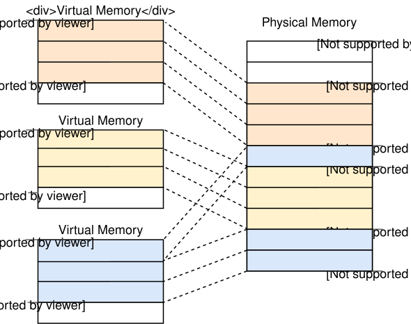
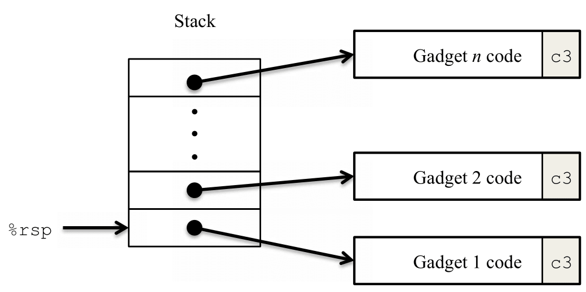
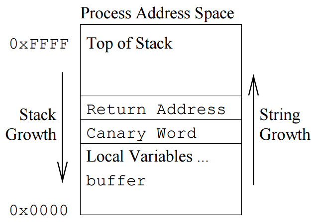

# Lab3: AttackLab

## 实验简介

本次实验将会帮助大家对程序运行时使用的内存空间和寄存器建立起基础的理解，并在此之上尝试做一些大家在程序设计课程中大概没有做过的事情——尝试从安全的视角审视程序。

助教在设计本次实验的过程中借鉴了本课程历史实验、[CSAPP Attack Lab](https://csapp.cs.cmu.edu/3e/attacklab.pdf) 和北京大学 2024 年秋 ICS 实验的设计，在此向它们的设计者表示感谢。

由于实验内容可能比较多，建议大家早些时候开始。如果遇到困难，欢迎大家随时[联系我](mailto:ryannyui06@gmail.com)，我会在保证公平的前提下尽可能帮助大家。

!!! info "提交方式和截止日期"

    点击 [模板仓库](https://github.com/ICS-26Fall-FDU/AttackLab) 页面右上角 「Use this template」 来在自己的账号下使用 Lab 模板新建一个仓库。

    所有同学应当在 eLearning 课程中 「作业」 页面提交自己的实验仓库链接，并在作业截止时间之前将自己完成的部分上传至 eLearning 上提交的实验仓库当中。实验仓库应当在自截止时间起至少 24 小时内维持 Public 状态。
    
    实验报告以 PDF 格式放置于仓库根目录。

    请确保所有修改在作业截止时都已经存在于仓库的 [Default Branch](https://docs.github.com/en/pull-requests/reference/branches#about-the-default-branch) 中。

    截止时间：Nov 27 23:59

## 程序的调用栈

大家在课堂上已经对程序的栈建立了很多了解，比如：

- 程序的栈是一块内存区域。
- x86-64 指令集当中栈是由高地址向低地址生长的。
- 栈中的元素叫作栈帧 (Stack Frame)。
- C 语言中每个普通函数在被调用时通常会创建一个自己的栈帧，在返回时释放掉自己的栈帧。
- 栈帧中保存对应函数内声明的局部变量。
- CPU 中存在一对寄存器来存储和栈相关的内存地址。（它们的名字是什么？）

为了防止和栈这种数据结构混淆，我们在实验接下来的部分中把程序的这一内存区域叫作 「调用栈」 (Call Stack)。

这个名字很好地反映了这一内存空间是怎么产生的——函数调用。

除此之外，它常见的名字还有 「执行栈」 、 「控制栈」 和 「运行时栈」 。

由于实验中接下来的部分我们会一直和调用栈打交道，我们有必要再仔细看一看在真正的程序中调用栈长什么样。

!!! abstract "安装 GEF"

    GEF (GDB Enhanced Features) 是一个 GDB 的插件，它在原生 GDB 的基础上提供了很多功能，其中之一是在暂停时输出非常详尽的汇编、栈帧、调用栈和寄存器信息，
    这能够大大改善大家的调试体验。

    请参照 [GEF 的文档](https://hugsy.github.io/gef/) 来安装它。

在 `attack/` 目录中执行 `gdb ./dark-calc` 来开始用 GDB 调试我们的目标可执行文件。

!!! note "任务：观察栈帧 `input`"

    在 GDB 中执行下述命令来在 input 函数处下一个断点并开始运行：
    ```
    gef➤  b input
    Breakpoint 1 at 0x40197f
    gef➤  r
    ```

    GEF 打印出了很多信息，请大家根据不同部分的信息（每一部分的标题在最右侧顶部）在实验报告中依次回答下列问题：

    1. 看看 trace 部分，input 函数是谁调用的？

    2. 看看 code:x86:64 部分，程序停下来的位置...似乎不是 input 函数的第一条指令。 停下来位置之前的三条指令[^1]是在做什么？ $rbp 此刻指向的内存地址当中的值来自哪里？

    3. 看看调用栈上 $rbp + 8 处，那里存的值是什么？（提示：运行 disas main 来查看它的汇编代码）

    4. 刚刚我们在 input 函数中读到的汇编代码似乎不能解释 $rbp + 8 处值的存在，我们需要找到它的来源。请你在 input 的调用者中找到 input 被调用的位置，在这里之前下一个断点，重新运行程序，并使用 `si` 命令从那里逐指令执行到我们的 input 断点，观察信息，回答是哪一行汇编代码在 $rbp + 8 处存入了值。

    5. 用同样的办法逐指令从 input 的 `leave` 指令之前处执行到 input 的调用者当中并观察每一步栈帧的变化，结合问题 2、问题 3 和 问题 4 回答 `call`、prologue、`leave` 和 `ret` [^2] 的作用。

    [^1]: 这三条指令叫作函数的 prologue。
    [^2]: `leave` 和 `ret` 合称函数的 epilogue。

现在我们已经了解了调用栈中的栈帧是如何建立的，以及函数间的控制流是怎么转移的。

接下来，让我们用学到的知识做一些危险的事情吧桀桀桀...

## 一个危险的漏洞

运行并探索一下 `attack` 目录下的 `dark-calc`。

这是我们编写的一个计算器程序，它的 `void input()` 函数打印提示语指导用户输入一个表达式并将表达式字符串存入全局变量 `command_buf` 中，随后 `void eval()` 函数将 `echo $((` 和 `))` 拼接在我们刚刚输入的表达式两侧并调用 `stdlib.h` 中提供的 `system()` 执行这一字符串，最终在标准输出流打印表达式的结果。

!!! info "`echo $(())` 是什么？"

    大家已经在较早时候发布的实验手册中了解到 `echo` 是一个 shell 命令，它可以将作为命令行参数传入的字符串打印到标准输出流。实验手册中还演示了将字符串输出到终端和利用重定向符号将字符串写入某个文件的方法。

    `$((some_expression))` 是 `bash` [算术扩展 (Arithmetic Expansion)](https://www.gnu.org/software/bash/manual/html_node/Arithmetic-Expansion.html) 的语法，它也是 POSIX 标准的一部分。它会将 `some_expression` 求值并将 `$((some_expression))` 整体替换为这个值。比如，`echo $(( 2 * 3 * 7 ))` 将会在标准输出流打印 `42`。

不幸的是，我们的代码中使用了一个过时且危险的函数，它的函数签名是 `char *gets(char *s)`。这个函数从标准输入流读取输入，存入 `s` 指向的内存空间，直到读入换行符或文件末尾，并将 `s` 作为返回值。

在我们的代码中，传入 `gets()` 的参数是 `input()` 函数栈帧上分配的 `char` 数组 `expression`。这个数组的大小是固定的 `MAXLEN+1` 个 `char`，也就是 16 bytes。

??? question "想一想，这里的 `+1` 是什么意思？"

    大家在程序设计课上应当学过，C 语言的字符串本质上就是一个元素类型为 char 的数组。指向这个数组首个元素的指针为我们标记了这个字符串的起始地址，但...我们怎么知道这个字符串什么时候结束呢？

    C 语言的解决办法是在整个字符串有效字符的最后再加一个 `\0`，也就是一个每一位都为 0 的字节，这会使整个字符串的内容比它实际的「有用」内容多一个字节。

    其他一些相对现代的编程语言，比如 Python、Go、C++、Rust 等等往往将实际长度数据和字符串数据同时存储，并用类型系统管理，比如对象、结构体、或是胖指针等等...

大家或许已经可以从上面两句话中发现矛盾了：`expression` 只有 16 字节的空间，但是 `gets()` 会在读入换行符或文件末尾之前一直往后写呀写呀写呀写。

那么当写入的内容大小超过 `expression` 中的空间时会怎么样呢？我们不妨来尝试一下。

!!! abstract "用不同长度的字符串输入测试 `dark-calc`"

    尝试在 `dark-calc` 中分别输入 20、32 个 ASCII 字符看看程序如何表现。（由于 `gets()` 还会额外写入一个 `\0`，所以写入数据的长度为 21 和 33 字节）如果报错了，看看报错是什么？

    使用 GDB 在 `input` 函数中调用的 `gets` 函数后下一个断点，再次尝试输入并观察栈帧，看看超量的数据被写到了哪里？

    在实验报告中回答上面两个问题。

这种漏洞叫作 **缓冲区溢出 (Buffer Overflow)** ，当发生在调用栈上时，它叫作 **Stack-based Buffer Overflow**。当程序没有对输入的数据进行长度检查时，攻击者可以通过构建超长的异常输入来篡改缓冲区高地址方向上的相邻数据。

还记得 `ret` 这条指令在干什么吗？现在到我们利用这个机制的时候了。

!!! note "任务：利用缓冲区漏洞执行 `./malware`"

    回想“程序的调用栈”部分中函数如何返回的机制，给 `dark-calc` 构造一个特殊的输入 (Payload) 以**利用栈溢出漏洞**，篡改 `input` 函数的返回地址，控制程序执行同一目录下的 `malware`。

    由于部分数据可能无法通过键盘输入，你应当将你的实现写在 `payload.py` 当中并将输出重定向以作为 `dark-calc` 的输入。
    
    如果实现正确，你将会在 `dark-calc` 的输出中看到 `You have successfully detonated the bomb! Congratulations!`。

    在实验报告中描述你的攻击流程。

    !!! info "提示"
        - 构造 payload 的示例：
          ``` python
          import sys
          payload = b'A' * 0x10 + b'\xd6\x05\x40\x00\x00\x00\x00\x00' # 16 个 A 和一个地址： 0x4005d6
          sys.stdout.buffer.write(payload)
          ```
          执行 `python payload.py`，payload 将会被输出到标准输出流中。

        - 管道操作符和重定向操作符可以帮助我们将 `python payload.py` 的输出重定向到 `dark-calc` 或某个文件。比如我们可以用 `python payload.py > payload` 来将输出存入 payload 文件中，随后在 GDB 中使用 `run < payload` 来输入。

        - POSIX Shell 中使用 # 号来表示注释。从 # 开始到该行的末尾的所有内容都会被 Shell 忽略。

        - 换行符的 ASCII 码是 0x0a，因此你的 payload 中间位置中不应当包含 0x0a。

        - 这一任务似乎还有不利用栈溢出漏洞解决的办法...？（不过请确保你提交的 payload 利用了栈溢出漏洞）

## 更多利用方式

在上一个任务中，我们利用这个缓冲区漏洞劫持了程序的控制流：我们跳过了拼接缓冲区中字符串的部分而直接用 `system()` 执行了缓冲区当中的命令。但这种简单的劫持控制流方法其实具有很大的局限性：它依赖于传入 `system()` 的指针正好指向我们想要让它执行的内容。

我们不妨换一个角度思考，与其依赖程序本身的代码来实现漏洞利用，有没有什么办法让程序更自由地执行一些我们想让它执行的指令呢？

大家已经知道：我们写的 C 代码会由编译器编译成汇编代码，然后由汇编器将人类可读的汇编代码翻译为机器码，最后再由链接器打包成一个完整的可执行文件。在一个程序启动时，将要给 CPU 执行的所有指令会以机器码的形式被加载到内存当中。


让我们用 GDB 来看一看这些机器码在内存中长什么样子。

!!! abstract "用 GDB 检查 main 函数的机器码"

    在 input 函数入口处下一个断点并执行到那里。
    使用 `disas` 命令列出 main 函数的汇编代码，找到 main 函数第一行指令对应机器码的起始地址，并使用 `x` (examine) 命令检查那里附近高地址方向上的内存区域，看看内存当中这些机器码的存储方式。并在实验报告中回答下面的问题：

    1. 前三行汇编对应的机器码分别是什么？
    2. 这些机器码在内存中排列的方式是什么样的？请你用文字或画一个图来说明。需要指出这三行指令分别对应的内存区间是什么。你可以在第一行指令处下一个断点，然后逐条指令执行，同时观察 rip 寄存器的值。

    !!! info "提示"
        - 如果你忘掉 `x` 的用法了，请看看 Lab2 的教学内容。 
        - 这个 [在线汇编器](https://defuse.ca/online-x86-assembler.htm) 可以将 Intel 语法的汇编代码翻译成 x86-64 机器码，大家可以使用它和内存中的数据对照查看。

既然我们已经清楚了内存中的机器码如何排布，那么我们有没有可能利用漏洞，在调用栈上塞入我们编写的机器码，将控制流转移到这里来执行呢？

!!! note "任务：栈空间执行"

    在之前做填充字符实验的时候，大家已经注意到了我们这个漏洞创造出的可写内存空间是相对有限的。在这有限的内存空间中当中还需要给返回地址留出 8 字节的空间，因此留给我们写指令的空间更加少了...

    因此，我们的在这里编写的指令不能很复杂。常见的利用方式是在这里写一小段程序，然后把这里作为一个跳板，巧妙利用程序本身的代码或我们发现的其他漏洞来完成我们想要达到的目标。

    在 `dark-calc` 中有一个未使用的 `grade_eval` 函数。尝试在阅读代码后，通过 `payload_dark.py` 构建新的 payload，将寄存器 `rip` 指向栈上我们编写的机器码。通过调用 `grade_eval`，让程序的输出中包含 "Hope A will be your grade!"。

    !!! info "提示"
        - 回想 x86-64 函数调用约定中的参数传递寄存器。
        - 使用汇编器来将汇编转换为机器码。

## 楚门的世界

刚刚我们的栈空间执行看起来很酷，但事实上这是我们故意营造出来的假象。不幸的是（或者说幸运的是），这样的攻击策略在现代计算机系统上会面临两个大问题。

1. 栈空间不可执行
2. 地址空间布局随机化（Address Space Layout Randomization, ASLR）

这两个机制在之前的任务中被绕过了。

我们先来看第一个问题：栈空间不可执行。

在未来的操作系统课程上，大家会学习到现代计算机管理内存空间的方式。简而言之，程序执行时所访问的内存地址并不是插/焊在主板上的 DRAM 中对应的物理地址，而是在一个虚拟的地址空间当中。计算机系统通过一张表按特定粒度管理虚拟地址空间到物理地址空间的映射。

<figure markdown="span">
  
  <figcaption>不同进程内存空间的映射</figcaption>
</figure>

这一机制有很大优势，比如进程隔离、更高效的内存管理，以及对我们当前问题最关键的——**权限控制**。

在这张映射表中，计算机不仅记录了“虚拟地址 A 对应物理地址 B”，还为每一块内存区域打上了权限标签：可读（**R**ead）、可写（**W**rite）、可执行（e**X**ecute）。每次 CPU 去内存里读写数据或者取指令时，硬件都会自动检查这些标签。一旦发现越权行为，硬件就会立刻拦截。

在第一个任务中，大家填充的数据超过调用栈区域过多时出现的 Segmentation Fault，就是由这一机制引起的。

在早期的计算机系统中，栈空间往往同时拥有“可写”和“可执行”的权限。但在现代计算机系统上，操作系统和编译器对于同时可写又可执行的内存是很谨慎的。比如内存中的代码段可读、可执行却不可写，而调用栈和堆可读可写却不可执行。即使操作系统提供了 API 让我们通过 `mmap` 去手动分配一块可写又可执行的内存为像是 JIT （或者我们的前两个任务）这样的需求服务，它也依然可以通过安全策略来限制这类内存的分配。

第二个问题是 ASLR。在刚刚的任务中，我们使用 GDB 查看了我们在栈上缓冲区里编写机器码的对应地址，将这一地址硬编码到我们的 payload 当中，然后在再次执行时使用硬编码上一次执行时缓冲区地址的 payload 作为输入。但...要是栈的起始地址在每次执行时都不同呢？

那么我们缓冲区的地址也会不同，刚刚编写的 payload 就会失效。

这就是 ASLR 的思想，通过让地址空间的布局变得随机来加大攻击者找到要跳转到的目标地址的难度。

助教编写了一个小程序 (`aslr.c`) 让大家来亲身体会一下 ASLR。

!!! abstract "ASLR"

    阅读并使用 `cc -o aslr aslr.c` 编译 aslr.c。反复多次执行 `aslr` ，查看其打印出的变量地址。[^3]

    [^3]: 在 GDB 中执行时打印出相同的内存地址是正常的，因为 GDB 为调试方便默认会禁用 ASLR。

!!! info "位置无关代码"

    ASLR 除了适用于栈空间、堆、动态链接库，还适用于代码段区域，但程序代码段的 ASLR 相对特殊。

    在栈上，我们之所以能够直接使用 ASLR，是因为我们对于栈上数据的寻址依赖于寄存器 `rbp`。比如 `input+28` 处：`lea rax,[rbp-0x10]`。无论栈的起始位置如何变化，这个局部变量和 `rbp` 的相对偏移是不变的 16 字节。

    而在代码段中，情况并不完全一样。部分程序的二进制文件代码段永远只会被加载到特定的基地址，不会发生变化。像这样的二进制可执行文件，我们把它叫作 Non-PIE binary. 其中 PIE 是 Position-Independent Executable 的缩写。

    像这样代码段不做随机偏移的程序在 x86 架构迈入 64 位时代之前是相当常见的。由于架构限制，在那时如果想要对代码段进行随机化偏移会产生相对较大的额外性能开销。

    [Eli Bendersky](https://github.com/eliben) 的两篇博客文章 [Position Independent Code (PIC) in shared libraries on x64](https://eli.thegreenplace.net/2011/11/11/position-independent-code-pic-in-shared-libraries-on-x64) 和 [Position Independent Code (PIC) in shared libraries](https://eli.thegreenplace.net/2011/11/03/position-independent-code-pic-in-shared-libraries/) 介绍了位置无关代码在 x86-64 前后的情况。

    考虑到实验难度，我们在本实验中提供的所有的二进制程序都不是 PIE。

随着栈不可执行和 ASLR 逐渐被主流操作系统内置，传统的栈空间执行落幕了。但在特定的程序上，我们依然有办法达到像是「栈空间执行」任务当中那样的效果！

一个比较常见的思路是利用内存空间中那些地址永远不变，且所在内存区域可执行的数据片段来拼凑出我们的程序，比如 non-PIE 中的 `.text` 部分。
这种编程方式叫作 **ROP (Return-Oriented Programming)**.

顾名思义，编程者（也就是大家）需要在程序内存空间中找到以 `ret` (0xc3) 结尾的一段或几段数据 (gadgets)，通过 `ret` 将控制流从一处 gadget 跳转到另一处 gadget，最终达到编程的目的。

比如说，假设 `.text` 段中存在如下指令：`mov eax, 0x00c3d0ff`，它的机器码是 `b8 ff d0 c3 00`。这一段数据中的 `ff d0 c3` 同时也可以是 `call *%rax; ret` 的机器码。假设我们需要调用 `rax` 当中存储的函数去执行命令，我们就可以将存在缓冲区溢出漏洞的那个函数的返回地址指向 `ff` 这一字节处，同时，在高地址方向上的接下来 8 字节写入下一段 gadget 的起始地址。

<figure markdown="span">
  
  <figcaption>ROP 的示例</figcaption>
</figure>

!!! note "任务：ROP"

    `dark-calc-nx` 是一个栈空间不可执行且栈空间位置随机的非 PIE 程序，你的任务是在 `payload_rop.py` 中使用 ROP 技术为其编写 payload，让程序的输出中包含 "Hope A will be your grade!"
    
    将你的攻击思路写在实验报告中。

    !!! info "提示"
        1. 任务需要使用的 gadget(s) 在 `0x4019d0` 到 `0x401ae3` 之间。由于范围不大，你可以在 objdump 导出的文件中直接寻找。
        2. 如果你发现使用立即数构造对应的参数存在困难，不妨利用栈来操作。
        3. 取决于你系统的 glibc 实现，你构造的 ROP 链可能会因为栈不对齐崩溃在 `printf` 内部，你需要通过搜索引擎解决这一问题。

## 猫鼠游戏

大家或许已经可以察觉到，计算机系统的安全性往往不依靠于某个单一的保护机制，而是作用于多个层级的不同机制独立作用又相辅相成的结果。为了让攻击者无法在栈上执行代码，安全工程师们在页表中加入了可执行权限位，而攻击者们又可以利用代码段的 gadget 来拼凑出自己想要的程序、为了让攻击者难以跳转到自己想要跳转的位置，安全工程师发明了 ASLR，而攻击者们又会去寻找其他可以泄露运行时绝对地址的漏洞，然后通过偏移计算出跳转的落点...

随着当代计算机系统复杂性不断提高，能被攻击者发掘出的攻击面也不断扩大，然后安全工程师们针对出现的漏洞提出对应的安全机制，攻击者再发掘出其他的攻击方式...这是一场永远不会结束的猫鼠游戏。

而对于缓冲区溢出漏洞这个历史久远而又利用空间巨大的漏洞，安全工程师们也有专门针对它的防御机制：**Stack Protector**。这一机制还有一个形象的别名：**Canary**。

<figure markdown="span">
  
  <figcaption>矿工与金丝雀</figcaption>
</figure>

在 19 世纪末 20 世纪初，我们还没有发明电子一氧化碳检测仪。在那时，煤矿工人下井时常常会带一只金丝雀。金丝雀对一氧化碳、甲烷等气体比人敏感得多：如果它突然躁动、倒下，矿工就知道空气出了问题，必须立刻撤离。金丝雀没有过滤毒气的功能，也不能阻止矿工吸入毒气，但是它可以用自己的反应向要保护的对象提前发出警告。

Stack Protector 的理念和金丝雀很像，编译器会在在局部缓冲区与保存的返回地址之间插入一个随机值 (Canary) 并在函数返回前进行校验。如果这个值发生变化，程序不会继续执行，而是调用 `__stack_chk_fail` 直接终止。

<figure markdown="span">
  
  <figcaption>栈上的金丝雀</figcaption>
</figure>

然而，聪明的攻击者们发现在某些特定的程序上，Stack Protector 是可以借助函数自身的代码被绕过的：既然一步到位从缓冲区写到返回地址无法实现，那我们有没有其他的办法来曲线救国呢？

!!! note "任务：Canary"

    `dark-log` 是我们为这个任务准备的简化程序。它依然是一个栈空间不可执行且位置随机的非 PIE 程序，但在编译时开启了 Stack Protector。你的任务是在 `payload_canary.py` 中编写代码，绕过 Canary，让程序的输出中包含 "Hope A will be your grade!"

    将你的攻击思路写在实验报告中。

    为了进一步阻止这种利用方式，现代编译器会对栈上局部变量存储的数据位置进行重新排布，我们在这里通过一个结构体固定顺序才创造出了利用空间。想一想，应当如何重新排列这些局部变量，才能使上述攻击失效？为什么？

    将你的思考写在实验报告中。

## 尾声

再次感谢我们、CMU 和 PKU ICS 课程的老师和助教，Lab3 是他们的智慧经由我-~~拙劣~~-拼接的结果。也感谢大家在这个 Lab 上花的时间。

在定稿之后，我尝试让 DeepSeek V4.1 Flash 1017 在 dsh 上自行完成了这个 Lab，共花费 13 分钟，0.5 元，其中大部分时间和 Token 都用在确保实验报告的严谨性上了，而几个 exploit 任务都是 one-shot。

一开始看到这个结果的时候，我是很沮丧的。因为我觉得，LLM 代写是无解的：我考虑过在二进制中投毒、在实验报告中添加更多主观题、增加题目难度...但发现这些办法都不可能解决这个问题，只会增加大家和我们的负担。

我后来想到 LLM 本身只可能会终结我们这种考察方式和评价体系。而对学习本身来说，它赋予了对此感兴趣的人前所未有的学习和自我提升的机会，也给予了对此并不那么感兴趣的人将时间花在自己感兴趣事情上的可能。从这个角度考虑，或许这是一件好事情。

对于感兴趣的同学，我希望这个 Lab 可以帮助你对「程序是如何执行的」这件事情建立更深入的认识。如果你对此的兴趣还不足以支撑你独立完成它，我也衷心祝愿你能在这个充满变化和奇迹的时代实现自己想要实现的目标。
