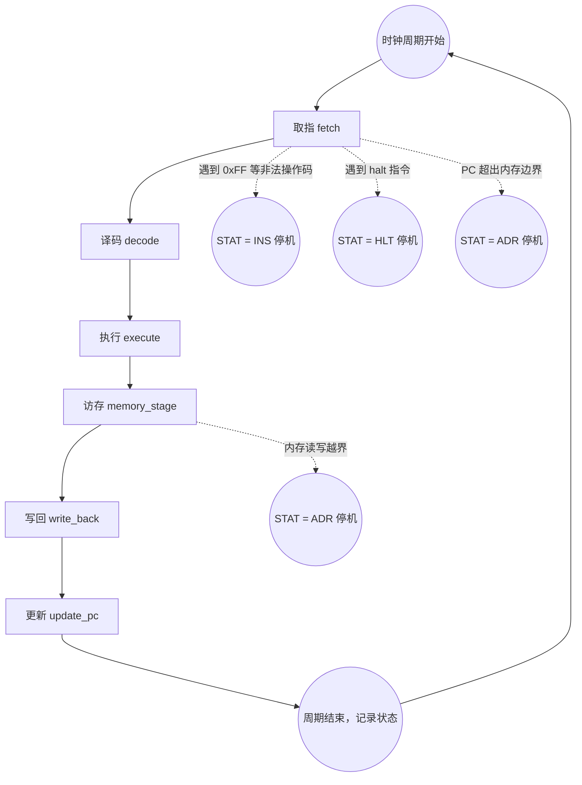

# PJ：Y86-64 CPU 模拟器

## 项目简介

CSAPP 第四章配套课程项目。

本项目需要基于课本中 Y86-64 指令集实现一个软件层面的模拟处理器，使其能够执行 Y86-64 指令。

## 项目要求与评分

总分 300 分。

- 实现项目基础功能（180 分）：单人完成项目。我们提供 C 与 Python 两种语言实现顺序执行处理器架构的基础框架，你需要实现每个阶段的基本功能，使之能够通过自动测试。
- 汇报（120 分）：按时提交 PPT，按要求完成期末汇报。

此项目在最终成绩中占比 30%。

## 基础功能实现

根据提供的 C 模板仓库或 Python 模板仓库创建仓库并提交链接，通过所有自动测试即可获得 180 分。

### CPU 架构导读

顺序执行的非流水线架构在同一个时钟周期内只允许一条指令在数据通路中流转。此架构的 CPU 执行一条指令一般分为以下阶段：

- **取指（Fetch）**：取指阶段从内存中读取指令的字节，使用程序计数器（PC）作为内存地址。
- **译码（Decode）**：从寄存器中读取用于运算的数据。
- **执行（Execute）**：算术/逻辑单元（ALU）执行当前指令，或执行算术运算或计算内存引用的有效地址，或增加或减少栈指针。其间可能会设置条件码。
- **访存（Memory）**：可能会将数据写入内存，或者从内存中读取数据。
- **写回（Write back）**：将最多两个数据写入寄存器。
- **更新PC（PC update）**：将PC更新为下一个指令的内存地址。

状态机的生命周期严格按照以下图示流转，你只需要集中精力实现图中的每个矩形框内部的具体逻辑即可：

*注：在 `memory_stage` 阶段，如果因为向非法地址（如负数地址）写入而触发了 `ADR` 异常，该指令的 `write_back` 阶段仍会执行（例如完成 `%rsp` 的递减写回），随后状态机才会在 `update_pc` 前被异常拦截并停机。这一逻辑已经为你写好。*

---

### 边界情况与特殊语义警告 (Corner Cases)

在实现具体逻辑时，请务必参考 CS:APP 课本第四章，严格遵守 Y86-64 架构下的一些极端行为规定，否则你的结果将无法通过自动化测试：

#### 栈操作的歧义语义

- **`pushq %rsp` 压入的是旧值还是新值？**
    根据 Y86-64 规范，`pushq %rsp` 压入内存的应当是**修改前（压栈前）的旧栈指针值**，而不是减去 8 之后的新值。
- **`popq %rsp` 弹栈行为**
    当执行 `popq %rsp` 时，CPU 会将栈指针加上 8，同时也会从内存中读取一个 8 字节的值。此时目标寄存器也是 `%rsp`。规范要求：**从内存中读出的值必须覆盖掉递增后的栈指针**。

#### 异常与机器状态 (`STAT`)

你需要通过修改 `self.STAT` 来正确抛出异常，测试集包含了对异常处理的严格考核：

- **非法指令 (`INS`)**：当 `fetch` 阶段读取到的 `icode` 不属于前文列出的合法指令集（例如测试集中出现了硬编码的 `.byte 0xFF`），必须将 `self.STAT` 置为 `INS` 并立刻返回，停止该指令后续阶段的执行。
- **非法内存访问 (`ADR`)**：不论是在 `fetch` 阶段取指超出了最大内存，还是在 `memory_stage` 阶段（例如 `pushq` 时栈指针已经到达 `0x0`，试图向 `-8` 的地址写入）发生越界，都必须将 `self.STAT` 置为 `ADR`。一旦置为 `ADR`，任何非法的内存读取必须返回 `0`，且非法的内存写入必须被静默拦截。

### 参考文档

- [Y86-64 指令集手册](https://cs.millersville.edu/~wkillian/archive/2019/fall/files/csci370/Y86-64%20Reference.pdf)

## 项目汇报

自第 12 周周五（或第 13 周实验课，取决于课程进度）开始至第 16 周课程结束，我们一周的课程时间将全部用于项目汇报展示。

### 汇报流程

汇报按照以下流程进行：

- 结合演示文稿简要地用自己的语言表述对 Y86_64 指令集中 11 种指令的分类，然后按指令的类别讲解：数据如何在你编写的六阶段流程中活动。（30 分）
- 结合演示文稿，描述在实现过程中，有什么印象深刻的地方？（15 分）
- 当场演示你的 CPU 如何处理一个偏长的 `.yo` 程序，简述此 `.yo` 程序的功能并分析它的控制流（执行时，代码从哪里跳到哪里）。（30 分）

    !!! info "此题的选择范围"
        `abs-asum-cmov.yo`、`abs-asum-jmp.yo`、`asum.yo`、`asumi.yo`、`asumr.yo`

- 展示你的 CPU 实现源代码，由 TA 在六个阶段中选择一个阶段，请你细粒度地描述关键的数据结构和方法。（45 分）

### 汇报要求与提示

- 具体汇报时间安排确定后（预计在第一次汇报前一周周五），我们会单独发布提交汇报演示文稿的 E-Learning 作业。请在汇报前提交演示文稿。
- 我们会在此作业中与课程群内发布汇报安排表格，请自行填写表格报名对应时间的汇报。注意汇报时间具有人数限制，先到先得。

!!! info "提早汇报加分"
    为鼓励大家积极报名较早的汇报时间，**第一次用来汇报的周五课程及以前**汇报的同学可以在期末总评中获得 3 分加分。此加分与“参与仓库协作”的加分**不能重复获得**。

- 汇报总体时间限制 10 分钟。TA 会提问引导同学的汇报节奏，超时时会让同学直接停止汇报。建议提前排练以控制流程中每个阶段的时间。
- 请使用清晰的自然语言表达自己的理解，尽量不要单纯念 AI 生成的文字，TA 评分时会考虑此因素。
- 考虑到演示效果，请尽量保持演示文稿的清晰易读，建议文字以总结性的短要点为主并使用较大字号，不要将代码截图和文字较多的段落放在演示文稿中。
